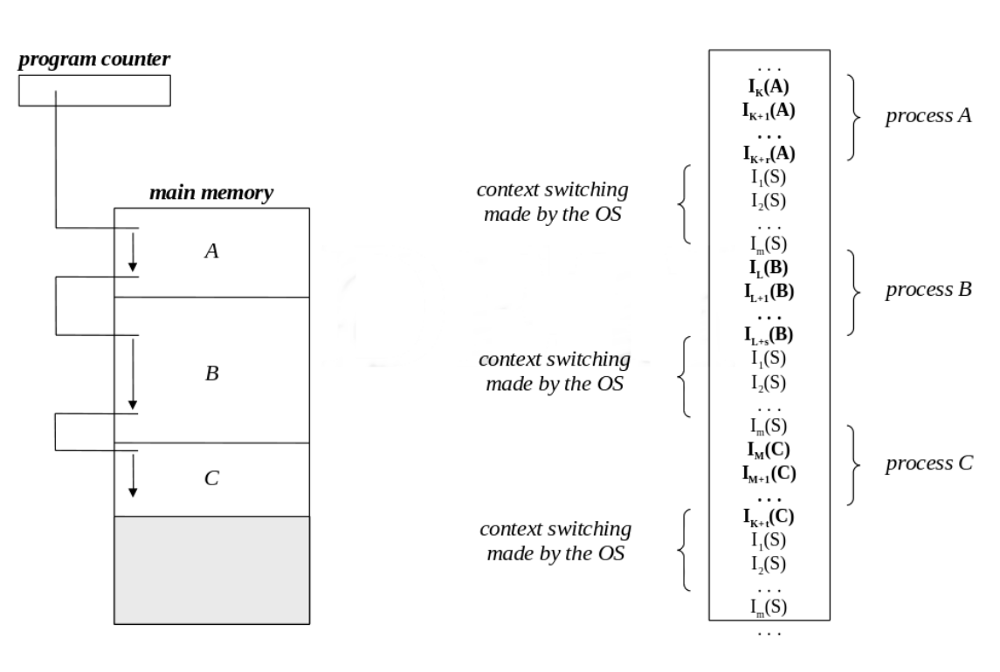
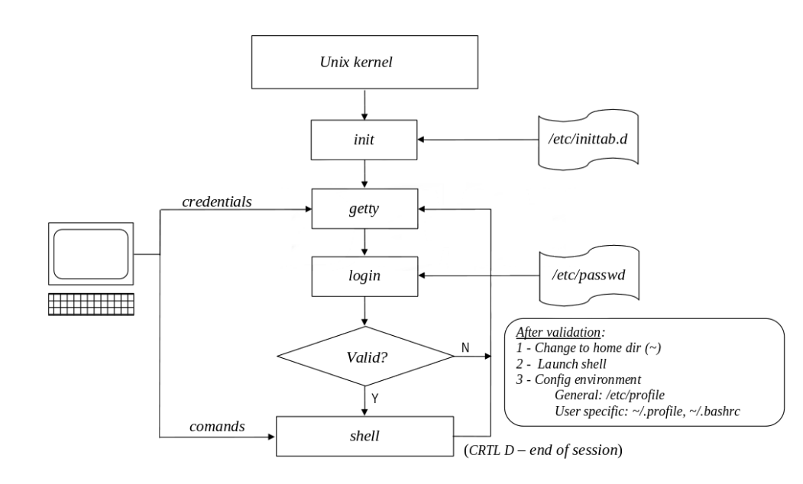
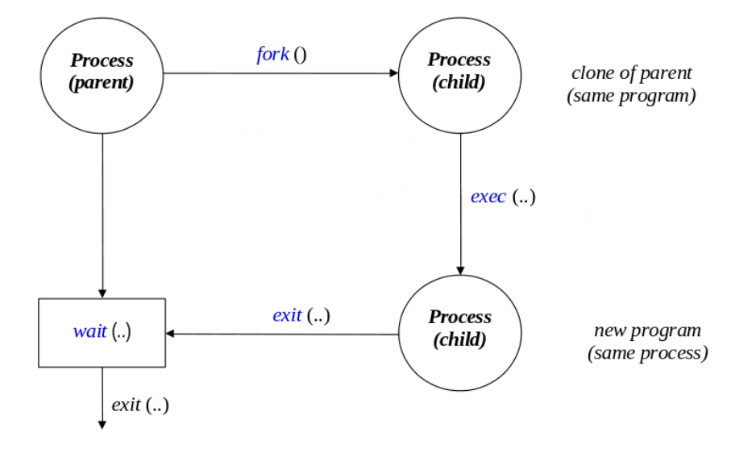
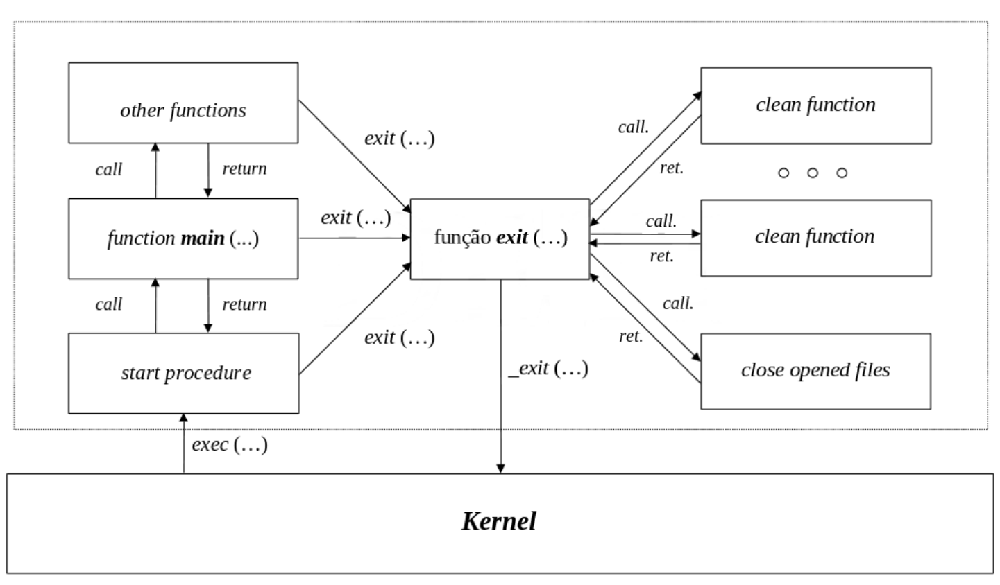
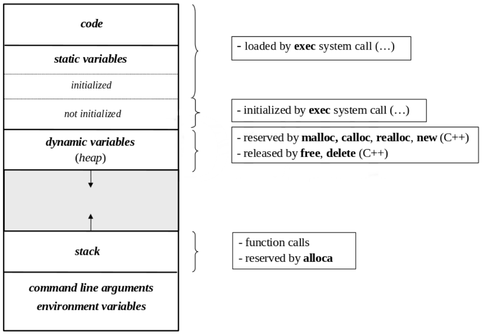

 
## 1. Programa vs. Processo
 
### 1.1 A ideia com uma analogia
 
- **Programa** = uma **receita de cozinha** escrita num livro. Está ali, parada. Não faz nada sozinha.
- **Processo** = **alguém a cozinhar** essa receita *agora*. Tem os ingredientes na bancada, sabe em que passo vai, tem as mãos ocupadas.

Formalmente (slide 4):
 
- **Programa** — conjunto de instruções que descreve *como* uma tarefa é executada por um computador. Para a tarefa ser mesmo feita, o programa tem de ser **executado**.
- **Processo** — uma entidade que representa **um programa em execução**. Representa uma atividade.

### 1.2 O que caracteriza um processo
 
Um processo é definido por:
 
1. **Espaço de endereçamento** — o código e os dados (valores atuais das variáveis) do programa.
2. **Dados de entrada e saída** — o que está a ser transferido de/para dispositivos (teclado, disco, ecrã...).
3. **Variáveis específicas do processo** — por exemplo o **PID** (*Process ID*, o "número do bilhete de identidade" do processo) e o **PPID** (*Parent PID*, o PID de quem o criou).
4. **Valores atuais dos registos do processador** (incluindo o *program counter*, que diz qual é a próxima instrução).
5. **Estado de execução** (a correr, à espera, etc.).

### 1.3 Duas frases importantes do slide
 
- **Processos diferentes podem estar a executar o mesmo programa.** (Dois utilizadores a abrir o mesmo editor de texto = 1 programa, 2 processos, cada um com os seus dados.)
- **Em geral há mais processos do que processadores** → é por isso que existe **multiprogramação** (próxima secção).
---
 
## 2. Multiprocessamento vs. Multiprogramação
 
Isto confunde muita gente. A diferença é simples:
 
### 2.1 Multiprocessamento = **Paralelismo** (de verdade)
 
- Capacidade de um sistema **executar simultaneamente** dois ou mais programas.
- **Exige mais do que um processador** (um para cada execução simultânea).
- Exemplo do slide: os programas A e B correm em paralelo num sistema com pelo menos 2 processadores. Os blocos de A e de B acontecem *ao mesmo tempo*.

Os slides mostram duas arquiteturas de exemplo:
- **SMP (symmetric processing)**: vários processadores P1...Pn ligados a **uma memória principal comum**.
- **Malha planar (planar mesh)**: processadores e memórias intercalados numa grelha.
### 2.2 Multiprogramação = **Concorrência** (ilusão)
 
- O sistema **parece** executar mais programas do que os processadores que tem.
- Como? O(s) processador(es) são atribuídos aos programas **à vez**, por fatias de tempo (*time multiplexed*).
- Exemplo do slide: A e B concorrentes num só processador: executa um bocadinho de A, depois um bocadinho de B, depois A, etc. Tão depressa que parece simultâneo.
- No slide aparece `t(A+B) < t(A)+t(B)`: o tempo total para fazer os dois, intercalados, é menor do que fazer um e depois o outro, porque os "buracos" de um são aproveitados pelo outro.
 
### 2.3 Execução num ambiente multiprogramado (slide 7)
 
O slide mostra:
 
- O **program counter** aponta para a instrução que o processador vai executar a seguir.
- Na **memória principal** estão os processos **A**, **B**, **C** (cada um com o seu bloco).
- À direita, a sequência de instruções executadas no tempo:

 
> **Troca de contexto (*context switching*)**: é o **sistema operativo** que, entre processos, executa código seu (o "S" do slide) para **guardar o estado** do processo que sai (registos, program counter...) e **carregar o estado** do processo que entra. É isto que cria a ilusão de que tudo corre ao mesmo tempo.
 
Pensa nisto como um professor a corrigir testes de vários alunos à vez: pega no teste do aluno A, marca onde ficou, pousa; pega no do B onde tinha ficado, etc.
 
---
 
## 3. Processos em Unix: como nascem
 
### 3.1 O *login* tradicional (slide 9)
 
Quando ligas um Unix e fazes *login*, passa-se uma cadeia de processos. O diagrama do slide:
 

 
**Depois da validação** acontece o seguinte:
1. Muda-se para a **pasta pessoal** do utilizador (`~`, o *home*).
2. **Lança-se a shell**.
3. **Configura-se o ambiente**:
   - geral: `/etc/profile`
   - específico do utilizador: `~/.profile`, `~/.bashrc`
Passo a passo para decorar:
1. O **kernel** arranca o primeiro processo: o **`init`**.
2. O `init` (guiado por `/etc/inittab.d`) lança um **`getty`** por cada terminal.
3. O `getty` pede o nome e a password e passa-os ao **`login`**.
4. O `login` verifica em **`/etc/passwd`**. Se **não** for válido, volta ao `getty`. Se for válido, lança a **shell**.
5. Quando fazes **CTRL+D**, a shell termina e volta ao `getty` para outra sessão.

### 3.2 Criação de processos por **clonagem** (slide 10)
 
Em Unix **não existe** uma chamada "cria um processo novo que corre o programa X". Em vez disso, fazem-se **duas coisas separadas**:
 
1. **Clonar** o processo atual → `fork()`
2. **Trocar o programa** do clone → `exec(...)`
O diagrama do slide:
 

 
- **`fork()`** — o pai cria um filho que é um **clone** (mesmo programa).
- **`exec(..)`** — o filho **substitui o programa** que está a correr por um novo. Continua a ser **o mesmo processo** (mesmo PID), mas agora a correr outro programa.
- **`exit(..)`** — o filho termina.
- **`wait(..)`** — o pai espera que o filho termine.
- **`exit(..)`** — por fim, o pai também termina.
> Frase para decorar: **`fork` = mesmo programa, novo processo. `exec` = mesmo processo, novo programa.**
 
Analogia: o `fork` é uma fotocopiadora que faz uma cópia de ti. O `exec` é dares à cópia outro trabalho para fazer, esquecendo tudo o que ela fazia antes.
 
---
 
## 4. A chamada ao sistema `fork`
 
> **Chamada ao sistema (*system call*)**: pedido que um programa faz diretamente ao sistema operativo para ele fazer algo que o programa não pode fazer sozinho (como criar processos).
 
### O que o `fork` faz (slide 12)
 
- **Clona** o processo que o chama, criando uma **réplica**.
- Os **espaços de endereçamento** dos dois são **iguais** (logo após o `fork` são mesmo "os mesmos"; tipicamente usa-se *copy on write*, ver secção 8.3).
- Os **estados de execução** são iguais, **incluindo o *program counter***: ambos continuam **na instrução logo a seguir ao `fork`**.
- Algumas variáveis do processo são **diferentes**: PID, PPID, ...
Includes necessários nos programas (repara que aparecem sempre):
 
```c
#include <stdio.h>      // printf
#include <stdlib.h>     // EXIT_SUCCESS
#include <sys/types.h>  // tipos como pid_t
#include <unistd.h>     // fork, getpid, getppid, exec...
```
 
---
 
### 4.1 Exemplo 1 — `fork0.cpp` (o `fork` mais simples)
 
```c
int main(void)
{
    printf("Hello, World!\n");
    fork();
    printf("Hello, World! Again\n");
    return EXIT_SUCCESS;
}
```
 
**Passo a passo:**
 
1. Só existe **um** processo. Imprime `Hello, World!`.
2. O `fork()` é chamado → **agora existem dois** processos (pai e filho).
3. **Os dois** continuam na linha a seguir ao `fork` → **ambos** imprimem `Hello, World! Again`.
4. Ambos fazem `return` e terminam.
**Saída num terminal:**
 
```
Hello, World!
Hello, World! Again
Hello, World! Again
```
 
- A 1.ª linha aparece **1 vez** (só o processo original existia).
- A 2.ª linha aparece **2 vezes** (pai e filho).
> **Cuidado com o *buffer* do `printf`!** Quando a saída **não** é um terminal (por exemplo `./fork0 | cat` ou `./fork0 > ficheiro.txt`), o `printf` guarda o texto num *buffer* e só o escreve mais tarde. Se o `fork` acontecer **antes** de esse buffer ser escrito, o filho **herda uma cópia do buffer** e o texto sai **duas vezes**. Quando o programa foi corrido com a saída redirecionada obtive:
>
> ```
> Hello, World!
> Hello, World! Again
> Hello, World!
> Hello, World! Again
> ```
>
> No terminal o `\n` faz o texto sair logo (buffer "por linha"), por isso não se repete.
> É exatamente por isso que o programa do slide 17 faz `fflush(stdout)` depois de cada `printf`: para forçar a escrita imediata e não duplicar texto.
 
---
 
### 4.2 Exemplo 2 — `fork1.cpp` (PID e PPID)
 
```c
int main(void)
{
  printf("Before the fork:\n");
  printf("  PID = %d, PPID = %d.\n", getpid(), getppid());
 
  fork();
 
  printf("After the fork:\n");
  printf("  PID = %d, PPID = %d.\n"
         " Am I the parent or the child?"
         " How can I know it?\n", getpid(), getppid());
 
  return EXIT_SUCCESS;
}
```
 
**Funções novas:**
- `getpid()` → devolve o **PID** do processo que a chama.
- `getppid()` → devolve o **PPID** (PID do processo pai).
**Passo a passo:**
 
1. Antes do `fork`, um só processo imprime o seu PID e o do pai (que é a shell que o lançou).
2. Faz o `fork`.
3. Depois do `fork`, **os dois** imprimem. Mas agora os valores são **diferentes**.
**Exemplo de saída** (números mudam sempre):
 
```
Before the fork:
  PID = 154, PPID = 96.        ← processo original (pai); o PPID 96 é a shell
After the fork:
  PID = 154, PPID = 96.        ← o pai: igual ao de antes
 Am I the parent or the child? How can I know it?
After the fork:
  PID = 155, PPID = 154.       ← o filho: PID novo; o PPID é o PID do pai!
 Am I the parent or the child? How can I know it?
```
 
**O que tirar daqui:**
- O **filho tem um PID novo** (155).
- O **PPID do filho = PID do pai** (154). É assim que a "árvore de processos" se forma.
- O programa pergunta no final: *"Sou o pai ou o filho? Como posso saber?"* → a resposta vem no exemplo seguinte.
---
 
### 4.3 Exemplo 3 — `fork2.cpp` (o valor devolvido pelo `fork`)
 
```c
int ret = fork();
 
printf("After the fork:\n");
printf("  PID = %d, PPID = %d.\n", getpid(), getppid());
printf("  ret = %d\n", ret);
```
 
**A regra mais importante desta aula:**
 
> O `fork()` **devolve valores diferentes** ao pai e ao filho:
> - **No pai** → devolve o **PID do filho**.
> - **No filho** → devolve **sempre 0**.
>
> Se o `fork` falhar, devolve **-1** e não é criado nenhum filho.
 
**Saída de exemplo:**
 
```
Before the fork:
  PID = 157, PPID = 96.
After the fork:
  PID = 158, PPID = 157.
  ret = 0                      ← este é o FILHO (ret = 0)
After the fork:
  PID = 157, PPID = 96.
  ret = 158                    ← este é o PAI (ret = PID do filho = 158)
```
 
Repara que o `ret` do pai (158) é igual ao PID do filho.
 
> A linha `Before the fork` pode aparecer repetida se redirecionares a saída (problema do buffer visto acima).
 
---
 
### 4.4 Exemplo 4 — `fork3.cpp` (separar o código do pai e do filho)
 
Como `ret` é 0 no filho e ≠ 0 no pai, usamo-lo como **condição de um `if`**:
 
```c
int ret = fork();
 
if (ret == 0)
{
    printf("I'm the child:\n");
    printf("  PID = %d, PPID = %d\n", getpid(), getppid());
}
else
{
    printf("I'm the parent:\n");
    printf("  PID = %d, PPID = %d\n", getpid(), getppid());
}
```
 
**Passo a passo:**
1. Depois do `fork` há dois processos, os dois com uma variável `ret`.
2. No **filho** `ret == 0` → entra no `if` → imprime "I'm the child".
3. No **pai** `ret != 0` → entra no `else` → imprime "I'm the parent".
**Saída de exemplo:**
 
```
Before the fork:
  PID = 160, PPID = 96.
I'm the child:
  PID = 161, PPID = 160
I'm the parent:
  PID = 160, PPID = 96
```
 
**Quem imprime primeiro?** Não se sabe! Pai e filho são **concorrentes**: o sistema operativo decide quem corre primeiro. Numa execução pode sair "child" primeiro, noutra "parent". Nunca deves assumir uma ordem (a não ser que a forces com `wait`, ver secção 5).
 
> **Resumo do `fork`:**
> 1. Cria uma cópia do processo.
> 2. Ambos continuam **depois** do `fork`.
> 3. `ret == 0` → és o **filho**. `ret > 0` → és o **pai** (e `ret` é o PID do filho).
 
O slide termina com uma pergunta: *"Still, what can we do with it?"* — de que serve só isto? Resposta: sozinho o `fork` tem pouco interesse. Precisamos de pôr o filho a **correr outro programa**: o `exec`.
 
---
 
## 5. `exec` e `wait`
 
### 5.1 A família `exec` (slide 15)
 
- O `exec` **substitui o programa** do processo atual por outro, lido do disco.
- O **PID mantém-se** (é o mesmo processo!), mas o código, os dados, a stack... passam a ser do novo programa.
- Há **várias versões** de `exec` (`execlp` é a que se usa nos slides).
- Se o `exec` **correr bem, nunca regressa** (o código que lá estava já não existe!). Só devolve (valor **-1**) se **falhar**.

### 5.2 Exemplo 5 — `fork4.cpp` (`fork` + `exec`, sem `wait`)
 
```c
int main(void)
{
  printf("Before the fork\n");
 
  int ret = fork();
 
  if (ret == 0)
  {
    execlp("ls", "ls", "-l", NULL);   // filho: passa a correr "ls -l"
    return EXIT_FAILURE;              // só chega aqui se o exec falhar
  }
  else
  {
    printf("I'm the parent\n");
    printf("And I will finish, "
           "without waiting for the child to finish\n");
  }
 
  return EXIT_SUCCESS;
}
```
 
**Como ler o `execlp("ls", "ls", "-l", NULL)`:**
 
| Argumento | Significado |
|---|---|
| `"ls"` (1.º) | Nome do programa a executar (procurado no `PATH`, por causa do **p** de `execlp`) |
| `"ls"` (2.º) | É o `argv[0]` do novo programa (o nome com que ele "se vê") |
| `"-l"` | É o `argv[1]`, o primeiro argumento real |
| `NULL` | **Marca o fim** da lista de argumentos (obrigatório!) |
 
Equivale a escreveres `ls -l` na shell.
 
**Passo a passo:**
1. O programa imprime `Before the fork`.
2. `fork()` → há pai e filho.
3. **Filho** (`ret == 0`): chama `execlp` → deixa de ser "este programa" e passa a ser o `ls -l`. O `return EXIT_FAILURE` **não** executa (a menos que o `exec` falhe).
4. **Pai**: imprime as duas mensagens e termina, **sem esperar** pelo filho.
**Saída de exemplo:**
 
```
Before the fork
I'm the parent
And I will finish, without waiting for the child to finish
total 208
-rw-rw-r-- 1 root root   200 Sep 23 16:17 Makefile
-rwxr-xr-x 1 root root 16160 Oct  2 22:26 atexit
... (resto da listagem)
```
 
**Problema:** como o pai não espera, pode terminar **antes** do filho acabar. Na shell, o *prompt* pode até aparecer **antes** de a listagem do `ls` acabar de sair, o que fica feio e confuso.
 
> Quando o pai morre antes do filho, o filho fica **órfão** e é "adotado" por outro processo (tradicionalmente o `init`, PID 1). Isto não vem nos slides.
 
### 5.3 A chamada `wait`
 
- `wait(NULL)` **bloqueia o pai** até **um dos seus filhos terminar**.
- Evita o problema acima e é o que permite **ordenar** a execução.
- Precisa de `#include <sys/wait.h>`.
- O `NULL` quer dizer "não me interessa saber como o filho terminou".
### 5.4 Exemplo 6 — `fork4a.cpp` (`fork` + `exec` + `wait`)
 
Igual ao anterior, mas no ramo do pai:
 
```c
  else
  {
    printf("I'm the parent\n");
    printf("And I will finish, "
           "after waiting for the child to finish\n");
    wait(NULL);                       // ← o pai espera pelo filho
  }
```
 
**Passo a passo:**
1. Pai e filho nascem.
2. O filho vira `ls -l` e imprime a listagem.
3. O pai imprime as mensagens e depois bloqueia em `wait(NULL)`.
4. Quando o `ls` termina, o `wait` regressa e o pai termina também.
Agora a ordem de **terminação** é garantida: **filho primeiro, pai depois**. Fica tudo arrumado, e o prompt só aparece no fim.
 
> **Nota dos slides:** nestes programas **assume-se que as chamadas ao sistema não falham**. Em caso de falha devolvem **-1**. Num programa a sério deves verificar isso.
 
## 6. O programa de ilustração do `fork` (1 2 3 4 5)
 
Este é o exemplo dos slides 17 e 18, que costuma sair em testes: **"Quais são as saídas possíveis?"**
 
No slide a espera é feita com `bwDelay(t)` (uma função da cadeira que espera *t* ocupando o CPU). Aqui usei `usleep`, que faz o mesmo efeito para o teste (esperar um bocadinho):
 
```c
int main(void)
{
    printf("1"); fflush(stdout);            // (A) só o pai existe
    int pid = fork();                       // (B) a partir daqui há 2 processos
    switch (pid)
    {
        case 0:                             // FILHO
            usleep(100000); printf("2"); fflush(stdout);
            usleep(100000); printf("3"); fflush(stdout);
            break;
        default:                            // PAI
            usleep(100000); printf("4"); fflush(stdout);
            usleep(100000); printf("5"); fflush(stdout);
            wait(NULL);                     // espera pelo filho
            printf("\n");
    }
    return EXIT_SUCCESS;
}
```
 
### Passo a passo (como nos slides)
 
1. **No início só existe o pai.** → o primeiro `printf("1")` só ocorre no pai. Só se escreve **um** `1`.
2. Quando o `fork` **começa**, ainda só existe o pai. Quando **termina**, existe também o filho, e há valor de retorno nos dois.
3. O `pid` é **0 no filho** e **≠ 0 no pai**.
4. Por isso **seguem caminhos diferentes**: o filho vai para `case 0`, o pai para `default`.
5. Pai e filho são **concorrentes**. O atraso pode influenciar o escalonamento → **não há maneira de saber quem imprime primeiro**.
6. Mas o **código de cada um é sequencial**: dentro do pai o **5 vem sempre depois do 4**; dentro do filho o **3 vem sempre depois do 2**.
7. O **`\n` final** só é impresso pelo pai **depois do `wait`**, ou seja, depois de o filho terminar. Logo sai sempre **por último**.
### Quais são as saídas possíveis?
 
O `1` vem sempre primeiro. Depois temos de **misturar** a sequência do filho (`2 3`) com a do pai (`4 5`), mantendo a ordem interna de cada uma:
 
| # | Saída |
|---|---|
| 1 | `12345` |
| 2 | `12435` |
| 3 | `12453` |
| 4 | `14235` |
| 5 | `14253` |
| 6 | `14523` |
 
(sempre seguidas de `\n`). São **6 possibilidades** (as formas de escolher 2 posições para o filho entre 4 = C(4,2) = 6).
 
**Exemplos de saídas impossíveis:** `15234` (o 5 antes do 4), `13245` (o 3 antes do 2), `21345` (o 1 não é primeiro).
 
Nas minhas execuções saíram sobretudo `14235` e `12453`, mas **todas as 6 são possíveis**, depende do escalonador.
 
---
 
## 7. Execução de um programa C/C++
 
### 7.1 Argumentos da linha de comandos e variáveis de ambiente (slide 20)
 
A função `main` pode ser declarada assim:
 
```c
int main(int argc, char *argv[], char *env[])
```
 
| Parâmetro | O que é |
|---|---|
| `argc` | **Número** de argumentos (conta com o nome do programa) |
| `argv` | **Array de strings** com os argumentos |
| `argv[0]` | A **referência ao programa** (como foi chamado, ex: `./cmd-args-env`) |
| `argv[1]` | O **primeiro argumento efetivo** passado ao programa |
| `env` | **Array de strings**, cada uma uma variável de ambiente na forma `NOME=valor` |
 
Tanto `argv` como `env` terminam com `NULL` (por isso os ciclos fazem `argv[i] != NULL`).
 
**O programa `cmd-args-env.cpp`:**
 
```c
int main(int argc, char *argv[], char *env[])
{
    /* 1) imprimir os argumentos */
    printf("Command line arguments:\n");
    for (int i = 0; argv[i] != NULL; i++)
        printf("  %s\n", argv[i]);
 
    /* 2) imprimir todas as variáveis de ambiente */
    printf("\nEnvironment variables:\n");
    for (int i = 0; env[i] != NULL; i++)
        printf("  %s\n", env[i]);
 
    /* 3) imprimir uma variável específica */
    printf("\nEnvironment variable:\n");
    printf("  env[\"HOME\"] = \"%s\"\n", getenv("HOME"));
    printf("  env[\"zzz\"] = \"%s\"\n", getenv("zzz"));
    unsetenv("HOME");
    printf("  env[\"HOME\"] = \"%s\"\n", getenv("HOME"));
 
    return EXIT_SUCCESS;
}
```
 
**Funções:**
- `getenv("NOME")` → devolve o **valor** da variável (ou `NULL` se não existir).
- `unsetenv("NOME")` → **apaga** a variável do ambiente **deste processo**.
**Se correres `./cmd-args-env a b "c d"`:**
 
```
Command line arguments:
  ./cmd-args-env       ← argv[0]
  a                    ← argv[1]
  b                    ← argv[2]
  c d                  ← argv[3]  (as aspas juntam "c d" num só argumento)
 
Environment variables:
  PIP_ROOT_USER_ACTION=ignore     ← (no teu PC aparecem dezenas: HOME, PATH, USER...)
 
Environment variable:
  env["HOME"] = "/root"           ← existe
  env["zzz"] = "(null)"           ← não existe (getenv devolveu NULL)
  env["HOME"] = "(null)"          ← acabámos de a apagar com unsetenv
```
 
Aqui `argc` vale **4** (`./cmd-args-env`, `a`, `b`, `c d`).
 
> O `(null)` que aparece é o `printf` a mostrar um ponteiro `NULL` com `%s` (a glibc faz isto por simpatia; noutros sistemas pode estoirar). Num programa sério verifica sempre se `getenv` devolveu `NULL` antes de usar.
 
> O que é o **ambiente**? É uma lista de pares `nome=valor` que cada processo recebe do pai (o `fork` copia-a, o `exec` pode passá-la). É assim que, por exemplo, o `ls` sabe qual é o teu `HOME`.
 
### 7.2 O que acontece desde o `exec` até ao fim (slide 21)
 
O diagrama do slide mostra o "ciclo de vida" de um programa C:
 


Em palavras:
1. O **kernel** carrega o programa com `exec`.
2. Corre um pequeno código de arranque, a **start procedure**, que **chama o `main`** (passando-lhe `argc`, `argv`, `env`).
3. O `main` faz o seu trabalho (chamando outras funções).
4. Quando o `main` faz **`return`**, quem recebe o valor é a start procedure, que chama **`exit(...)`** com esse valor. (Por isso `return EXIT_SUCCESS;` no `main` é equivalente a `exit(EXIT_SUCCESS);`.)
5. O **`exit(...)`** chama as **funções de limpeza** registadas (com `atexit`) e **fecha os ficheiros abertos** (escrevendo o que estiver em *buffer*).
6. Por fim o `exit` chama **`_exit(...)`**, que é a chamada ao sistema que **entrega o processo ao kernel** para ele o destruir.
> `exit` (da biblioteca C) = limpa e depois chama `_exit`. `_exit` (do sistema) = termina **imediatamente**, sem limpezas.
 
### 7.3 `atexit` (slide 22)
 
- `atexit(f)` **regista** uma função `f` para ser chamada **na terminação normal** do programa.
- As funções registadas são chamadas **pela ordem inversa** do registo (a última registada corre primeiro, como uma pilha de pratos).
```c
static void atexit_1(void) { printf("atexit 1\n"); }
static void atexit_2(void) { printf("atexit 2\n"); }
 
int main(void)
{
    atexit(atexit_1);                      // registada em 1.º lugar
    atexit(atexit_2);                      // registada em 2.º lugar
 
    printf("hello world 1!\n");
    for (int i = 0; i < 5; i++) sleep(1);  // espera 5 segundos
 
    return EXIT_SUCCESS;                   // → exit() → chama as funções
}
```
 
**Saída (ao fim de 5 s):**
 
```
hello world 1!
atexit 2          ← a última a ser registada é a primeira a correr
atexit 1
```
 
**A pergunta do slide: "O que acontece se a terminação for forçada?"**
(Resposta minha, o slide deixa a pergunta em aberto.)
 
Se matares o programa de fora (por exemplo com **CTRL+C** durante os 5 segundos, ou com `kill -9`), o processo é destruído pelo sistema **sem passar pelo `exit`** → as funções do `atexit` **não são chamadas**. Só aparece `hello world 1!` (e nem isso se a saída estiver redirecionada, porque fica no buffer).
 
---
 
## 8. Espaço de endereçamento de um processo Unix
 
> **Espaço de endereçamento** = a "memória" que o processo vê, organizada em zonas. Cada processo vê o **seu** espaço, como se fosse dono de toda a memória.
 
### 8.1 As zonas (slide 24)
 

 
| Zona | O que lá fica | Quem a preenche |
|---|---|---|
| **Código** | As instruções do programa (incluindo as funções `main`, `f1`...) | `exec` |
| **Estáticas inicializadas** | Globais e `static` com valor inicial (`int n1 = 1;`) | `exec` |
| **Estáticas não inicializadas** | Globais e `static` sem valor (`int n3;`) | `exec` (põe a zero) |
| **Heap** | Memória pedida em execução: `malloc`, `calloc`, `realloc`, `new` | O programa (e liberta com `free`/`delete`) |
| **Stack** | Variáveis locais, parâmetros, endereços de retorno das chamadas a funções, memória de `alloca` | Cresce e encolhe a cada chamada/retorno |
| **Topo** | `argv` e `env` | `exec` |
 
> **Heap e stack crescem um para o outro** e há um espaço livre no meio. Se se encontrarem, a memória acabou.
 
### 8.2 O programa `mem.cpp`: onde fica cada variável?
 
```c
int n1 = 1;              // global, inicializada
static int n2 = 2;       // global static, inicializada
int n3;                  // global, não inicializada
static int n4;           // global static, não inicializada
int n5;                  // global, não inicializada
static int n6 = 6;       // global static, inicializada
 
int main(int argc, char *argv[], char *env[])
{
    extern char** environ;
    static int n7;                          // static local, não inicializada
    static int n8 = 8;                      // static local, inicializada
    int *n9  = (int*)malloc(sizeof(int));   // ponteiro (stack) → inteiro no HEAP
    int *n10 = (int*)malloc(sizeof(int));   // ponteiro (stack) → inteiro no HEAP
    int *n11 = (int*)alloca(sizeof(int));   // ponteiro (stack) → inteiro na STACK
    int n12;                                // local (stack)
    int n13 = 13;                           // local (stack)
    int n14;                                // local (stack)
    ... printf's que mostram os endereços ...
}
```
 
**Classificação:**
 
| Variável | Onde fica | Porquê |
|---|---|---|
| `n1`, `n2`, `n6` | Estáticas **inicializadas** | Globais com valor inicial (o `static` global só limita a visibilidade ao ficheiro) |
| `n3`, `n4`, `n5` | Estáticas **não inicializadas** | Globais sem valor inicial |
| `n8` | Estáticas **inicializadas** | `static` local: vive durante todo o programa, não na stack |
| `n7` | Estáticas **não inicializadas** | `static` local sem valor |
| `n9`, `n10` (as **variáveis**) | **Stack** | São ponteiros locais |
| `*n9`, `*n10` (para onde apontam) | **Heap** | Reservados com `malloc` |
| `n11` (a variável) | **Stack** | Ponteiro local |
| `*n11` (para onde aponta) | **Stack** | `alloca` reserva na stack |
| `n12`, `n13`, `n14` | **Stack** | Variáveis locais |
| `argc`, `argv` (as variáveis) | **Stack** | Parâmetros de `main` |
| texto de `argv[i]` e `env[i]` | **Topo** | Zona de argumentos e ambiente |
| `main`, `f1` (funções) | **Código** | |
 
**Armadilha clássica:** `int *n9 = malloc(...)` tem **duas coisas** diferentes: o ponteiro `n9` (na stack) e o inteiro para onde ele aponta (no heap). No `printf` do programa imprime-se `n9` (o *valor* do ponteiro = endereço no heap), enquanto das outras se imprime `&n1` (o *endereço* da variável).
 
**Saída real (os endereços mudam de execução para execução):**
 
```
main = 0x55acb90421a9          ← CÓDIGO
f1   = 0x55acb904239e          ← CÓDIGO
 
&n1 = 0x55acb9045010           ┐
&n2 = 0x55acb9045014           │ estáticas inicializadas (n1, n2, n6, n8)
&n6 = 0x55acb9045018           │ → endereços vizinhos
&n8 = 0x55acb904501c           ┘
&n3 = 0x55acb904502c           ┐
&n5 = 0x55acb9045030           │ estáticas não inicializadas (n3, n4, n5, n7)
&n4 = 0x55acb9045034           │ → logo a seguir às inicializadas
&n7 = 0x55acb9045038           ┘
 
n9  = 0x55acbb0052a0           ┐ HEAP (valores 0x55acbb...: mais acima das estáticas)
n10 = 0x55acbb0052c0           ┘
 
n11  = 0x7ffe340fa400          ┐
&n12 = 0x7ffe340fa434          │ STACK (0x7ffe...: endereços muito altos)
&n13 = 0x7ffe340fa438          │
&n14 = 0x7ffe340fa43c          │
&argc = 0x7ffe340fa42c         ┘
 
argv    = 0x7ffe340fa588       ┐ TOPO (argv/environ são os maiores:
environ = 0x7ffe340fa598       ┘ ficam acima da stack)
```
 
**O que se vê:**
- Código e estáticas: endereços **baixos** e próximos (`0x55ac...9...`).
- Heap: um pouco **acima** (`0x55ac...b...`).
- Stack e topo: endereços **altíssimos** (`0x7ffe...`), com `argv`/`env` **acima** das variáveis locais.
- As duas reservas `malloc` estão separadas por 0x20 = 32 bytes (o `malloc` guarda informação extra e arredonda).
> Os endereços mudam em cada execução por causa do **ASLR** (um mecanismo de segurança que baralha as posições). O que se mantém é a **ordem relativa** das zonas.
 
### 8.3 Pai e filho têm memória separada: `mem-fork.cpp`
 
```c
int n01 = 1;                                  // global
 
int main(int argc, char *argv[], char *env[])
{
    int pid = fork();
    if (pid != 0)                             // PAI
    {
        fprintf(stderr, "%5d: n01 = %-5d (%p)\n", pid, n01, &n01);
        wait(NULL);                           // espera pelo filho
        fprintf(stderr, "%5d: n01 = %-5d (%p)\n", pid, n01, &n01);
    }
    else                                      // FILHO
    {
        fprintf(stderr, "%5d: n01 = %-5d (%p)\n", pid, n01, &n01);
        n01 = 1111;                           // o filho MUDA a variável
        fprintf(stderr, "%5d: n01 = %-5d (%p)\n", pid, n01, &n01);
    }
    return 0;
}
```
 
(Usa-se `stderr` porque não tem buffer: assim o texto sai logo e não se duplica com o `fork`.)
 
**Passo a passo:**
1. Depois do `fork`, o **filho tem uma cópia** da variável `n01` (valor 1).
2. O filho imprime `n01 = 1`, depois **altera** para `1111` e imprime outra vez.
3. O pai espera pelo filho e só depois imprime `n01`.
4. Pergunta: o pai vê 1 ou 1111?
**Saída real:**
 
```
    0: n01 = 1     (0x565277857010)     ← filho (pid = 0), antes de alterar
    0: n01 = 1111  (0x565277857010)     ← filho, depois de alterar
  175: n01 = 1     (0x565277857010)     ← pai (pid = 175 = PID do filho)
  175: n01 = 1     (0x565277857010)     ← pai, DEPOIS do filho alterar: continua 1!
```
 
**Conclusões:**
 
1. O **pai continua a ver 1**: cada processo tem a **sua própria cópia** da memória. Mudar uma variável num processo **não afeta** o outro.
2. Mas o **endereço impresso é o mesmo** nos dois! Como é possível? Porque os endereços que o programa vê são **endereços virtuais** (cada processo tem o seu "mapa"). O mesmo endereço virtual pode apontar para **sítios diferentes** na memória física real.
3. **Copy on write** (cópia ao escrever): para não gastar tempo e memória a copiar tudo no `fork`, o sistema deixa pai e filho **partilharem** a mesma memória física. Só quando um deles **escreve** é que o sistema faz uma cópia dessa parte. Daí o *"tipicamente, copy on write"* do slide 12. Uma analogia: dois colegas partilham os mesmos apontamentos; quando um quer rabiscar, fotocopia a página primeiro.
4. A ordem das linhas entre pai e filho pode variar (são concorrentes), mas dentro de cada processo a ordem é sequencial.
---
 
## 9. Resumo final (cábula)
 
### Conceitos
 
| Conceito | Em uma frase |
|---|---|
| Programa | Instruções (a receita), parado |
| Processo | Programa em execução (alguém a cozinhar), com PID, memória, registos, estado |
| Paralelismo / multiprocessamento | Simultâneo **a sério**, ≥ 2 processadores |
| Concorrência / multiprogramação | Ilusão de simultâneo, processador partilhado à vez |
| Troca de contexto | O SO guarda o estado de um processo e carrega o de outro |
| PID / PPID | Identificador do processo / do pai |
 
### Funções
 
| Função | Para que serve | Devolve |
|---|---|---|
| `fork()` | Clona o processo | **0** no filho; **PID do filho** no pai; **-1** se falhar |
| `getpid()` | PID do próprio processo | PID |
| `getppid()` | PID do pai | PPID |
| `execlp(prog, argv0, arg1, ..., NULL)` | Troca o programa do processo | Só regressa (com -1) se falhar |
| `wait(NULL)` | Pai espera que um filho termine | PID do filho (ou -1) |
| `exit(n)` | Termina limpando (atexit + fecha ficheiros) | — |
| `_exit(n)` | Termina já, sem limpezas | — |
| `atexit(f)` | Regista `f` para o fim normal; chamadas por ordem **inversa** | — |
| `getenv("X")` | Valor da variável de ambiente | `char*` ou `NULL` |
| `unsetenv("X")` | Apaga variável de ambiente | — |
| `malloc/calloc/realloc/new` | Reservam no **heap** | ponteiro |
| `free/delete` | Libertam do heap | — |
| `alloca` | Reserva na **stack** | ponteiro |
 
### Padrão clássico (decorar!)
 
```c
int ret = fork();
if (ret == 0) {
    // FILHO: normalmente troca de programa
    execlp("ls", "ls", "-l", NULL);
    return EXIT_FAILURE;          // só se o exec falhar
} else {
    // PAI: espera pelo filho
    wait(NULL);
}
```
 
### Erros comuns
 
- Assumir que o pai imprime antes do filho (ou vice-versa). **Não há ordem garantida** sem `wait`.
- Esquecer o `NULL` no fim do `execlp`.
- Pensar que o `exec` cria um processo novo. **Mantém o PID.**
- Pensar que o filho "partilha" variáveis com o pai. **Cada um tem a sua cópia.**
- Esquecer o `fflush` (ou o `\n`) antes do `fork` com saída redirecionada e ver texto duplicado.
- Confundir o ponteiro (na stack) com a memória para onde aponta (no heap).
 
---
 
## 10. 20 perguntas de escolha múltipla
 
> Tenta responder sem ver as soluções. Respostas e explicações na secção 11.
 
**1.** Qual das afirmações sobre programa e processo é **verdadeira**?

- A) Um programa e um processo são exatamente a mesma coisa.
- B) Um processo é um conjunto de instruções guardado no disco.
- C) Vários processos podem estar a executar o mesmo programa.
- D) Cada programa só pode originar um processo de cada vez.

**2.** Qual destes elementos **não** faz parte da caracterização de um processo nos slides?

- A) Espaço de endereçamento
- B) Valores atuais dos registos do processador
- C) PID e PPID
- D) O ficheiro de código-fonte `.cpp` guardado no disco

**3.** A **concorrência** (multiprogramação) caracteriza-se por:

- A) Exigir sempre mais do que um processador.
- B) Criar a ilusão de simultaneidade, partilhando o(s) processador(es) no tempo entre os programas.
- C) Executar sempre dois programas no mesmo instante.
- D) Só existir em sistemas SMP.

**4.** Na troca de contexto entre os processos A e B, quem executa o código que guarda e restaura o estado dos processos?

- A) O processo A
- B) O processo B
- C) O sistema operativo
- D) A shell

**5.** Qual é a ordem correta dos processos no *login* tradicional em Unix?
- A) `login` → `init` → `getty` → `shell`
- B) `init` → `getty` → `login` → `shell`
- C) `getty` → `init` → `shell` → `login`
- D) `init` → `login` → `getty` → `shell`

**6.** Imediatamente depois de um `fork()`, o que é **diferente** entre pai e filho?
- A) O código do programa
- B) O valor do program counter
- C) O PID e o PPID
- D) O conteúdo inicial das variáveis

**7.** Qual é o valor devolvido pelo `fork()` **no processo filho**?
- A) O PID do pai
- B) O PID do filho
- C) -1
- D) 0

**8.** Qual é o valor devolvido pelo `fork()` **no processo pai** (quando corre bem)?
- A) 0
- B) O PID do filho
- C) O PID do próprio pai
- D) 1

**9.** Num terminal, quantas vezes aparece a linha `Hello, World! Again` ao correr `fork0`?
```c
printf("Hello, World!\n");
fork();
printf("Hello, World! Again\n");
```

- A) 0
- B) 1
- C) 2
- D) 4

**10.** Se se correr o mesmo `fork0` com a saída redirecionada para um ficheiro, a linha `Hello, World!` pode aparecer **duas vezes**. Porquê?

- A) Porque o `fork` executa o `printf` duas vezes.
- B) Porque o texto ainda estava no *buffer* quando o `fork` clonou o processo, e o filho herdou uma cópia desse buffer.
- C) Porque o ficheiro é escrito pelo pai e pelo filho em simultâneo.
- D) Porque o `exit` repete as mensagens.

**11.** O que faz a chamada `exec` (por exemplo `execlp`)?
- A) Cria um novo processo com um novo PID.
- B) Termina o processo e espera pelo pai.
- C) Substitui o programa do processo atual por outro, mantendo o mesmo processo (e PID).
- D) Duplica o espaço de endereçamento do processo.

**12.** Em `fork4.cpp`, porque é que existe `return EXIT_FAILURE;` logo a seguir ao `execlp(...)` no ramo do filho?

- A) Porque o `execlp` devolve sempre um valor que precisa de ser tratado.
- B) Porque essa linha só é executada se o `execlp` falhar, já que, se correr bem, o código antigo deixa de existir.
- C) Porque o filho tem sempre de terminar com erro.
- D) Porque o pai o exige.

**13.** Em `execlp("ls", "ls", "-l", NULL)`, o que representa o **segundo** `"ls"`?

- A) O nome do ficheiro de saída.
- B) O `argv[0]` do novo programa.
- C) Uma opção do comando.
- D) O diretório onde procurar.

**14.** Qual é a diferença entre `fork4.cpp` e `fork4a.cpp`?

- A) `fork4a` não usa `fork`.
- B) `fork4a` usa `wait(NULL)`, por isso o pai só termina depois de o filho terminar.
- C) `fork4a` executa `ls` no pai.
- D) `fork4a` cria dois filhos.

**15.** No programa de ilustração dos slides (o pai imprime `4 5`, o filho imprime `2 3`, depois do `1` inicial), qual destas saídas é **impossível**?

- A) `12453`
- B) `14235`
- C) `15234`
- D) `12345`

**16.** Se executares `./cmd-args-env a b "c d"`, quanto vale `argc`?
- A) 3
- B) 4
- C) 5
- D) 2

**17.** No programa `atexit.cpp`, onde se registou `atexit_1` e depois `atexit_2`, o que é impresso no fim da execução normal?

- A) `atexit 1` e depois `atexit 2`
- B) `atexit 2` e depois `atexit 1`
- C) Só `atexit 1`
- D) Nada, porque o `return` não chama o `exit`

**18.** O que acontece às funções registadas com `atexit` se o programa for terminado à força (por exemplo com `kill -9`)?

- A) São chamadas pela ordem inversa, na mesma.
- B) São chamadas pela ordem de registo.
- C) Não são chamadas, porque o processo é destruído sem passar pelo `exit`.
- D) São chamadas pelo filho.

**19.** Em `int *n9 = (int*)malloc(sizeof(int));` dentro do `main`, onde ficam, respetivamente, a variável `n9` e o inteiro para onde ela aponta?

- A) `n9` no heap e o inteiro na stack.
- B) Ambos no heap.
- C) Ambos na zona de estáticas.
- D) `n9` na stack e o inteiro no heap.

**20.** Em `mem-fork.cpp`, o filho faz `n01 = 1111`. Depois de o filho terminar, o pai imprime `n01`. O que se vê?

- A) 1111, com um endereço diferente.
- B) 1, com o **mesmo endereço** (virtual) impresso pelo filho.
- C) 1111, com o mesmo endereço.
- D) 0, porque o filho já terminou.

---
 
## 11. Soluções
 
**1 → C.** Vários processos podem executar o mesmo programa (slide 4). Um programa é a "receita"; cada execução é um processo.
 
**2 → D.** O código-fonte no disco é parte do programa, não do processo. O processo é caracterizado por espaço de endereçamento, dados de E/S, variáveis (PID, PPID), registos e estado.
 
**3 → B.** Concorrência = ilusão de simultaneidade com o processador a ser repartido no tempo. Pode existir com um único processador.
 
**4 → C.** A troca de contexto é feita pelo sistema operativo (o "S" dos slides).
 
**5 → B.** `init` → `getty` → `login` → `shell`.
 
**6 → C.** Código, program counter e variáveis são iguais logo após o `fork`; PID e PPID são diferentes (o PPID do filho é o PID do pai).
 
**7 → D.** No filho, o `fork` devolve sempre 0.
 
**8 → B.** No pai devolve o PID do filho (se falhar, -1).
 
**9 → C.** O `printf` final é executado por dois processos (pai e filho). A primeira linha só aparece uma vez porque o `\n` descarrega o buffer num terminal antes do `fork`.
 
**10 → B.** Com a saída redirecionada o buffer não é descarregado ao `\n`; o `fork` copia o buffer para o filho e ambos o escrevem no fim.
 
**11 → C.** `exec` troca o programa mantendo o processo e o PID. Quem cria processos é o `fork`.
 
**12 → B.** Se o `execlp` correr bem nunca regressa; o `return` só é alcançado em caso de falha.
 
**13 → B.** O primeiro `"ls"` é o programa a procurar no `PATH`; o segundo é o `argv[0]`; depois vêm os argumentos e o `NULL` final.
 
**14 → B.** A única diferença é o `wait(NULL)` no pai (e o `#include <sys/wait.h>`).
 
**15 → C.** `15234` coloca o 5 antes do 4, e dentro do pai o 5 vem sempre depois do 4. As outras três são das 6 possíveis (`12345`, `12435`, `12453`, `14235`, `14253`, `14523`).
 
**16 → B.** `argc` conta o nome do programa: `./cmd-args-env`, `a`, `b`, `c d` = 4 (as aspas fazem de `c d` um só argumento).
 
**17 → B.** As funções são chamadas por ordem inversa do registo: `atexit 2` e depois `atexit 1`.
 
**18 → C.** Com terminação forçada o processo morre sem passar pelo `exit`, logo as funções do `atexit` não são chamadas. (O mesmo acontece com `_exit`.)
 
**19 → D.** O ponteiro `n9` é uma variável local (stack); a memória reservada por `malloc` está no heap.
 
**20 → B.** Cada processo tem a sua cópia da variável (copy on write): o pai continua a ver 1. O endereço impresso é igual porque são endereços virtuais, que em cada processo apontam para memória física diferente depois de o filho escrever.
 
---
 
*Fim do caderno da Aula 2. Bom estudo! 🚀*
 
